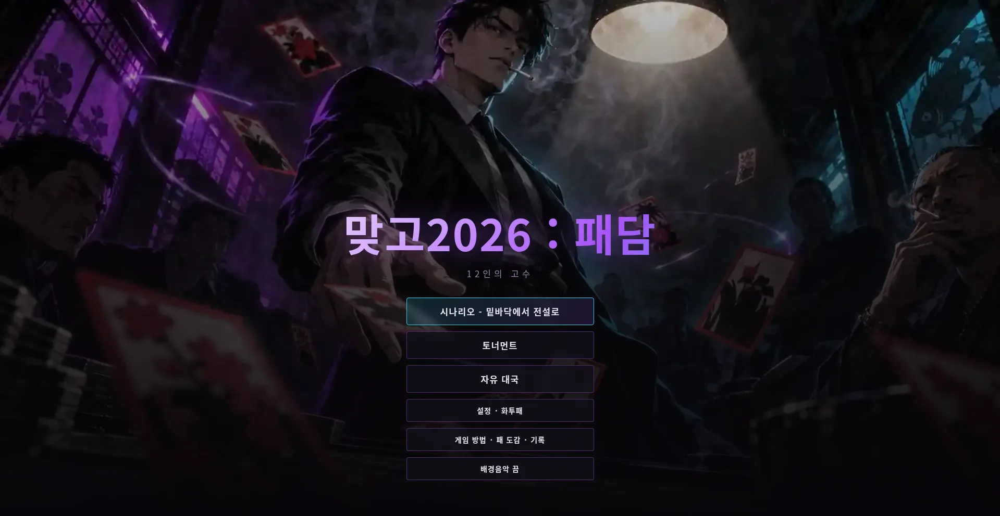
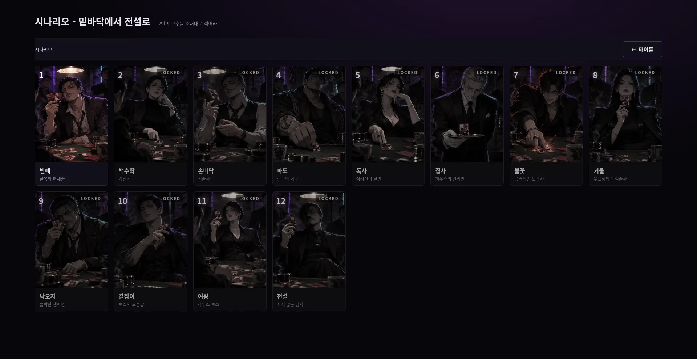
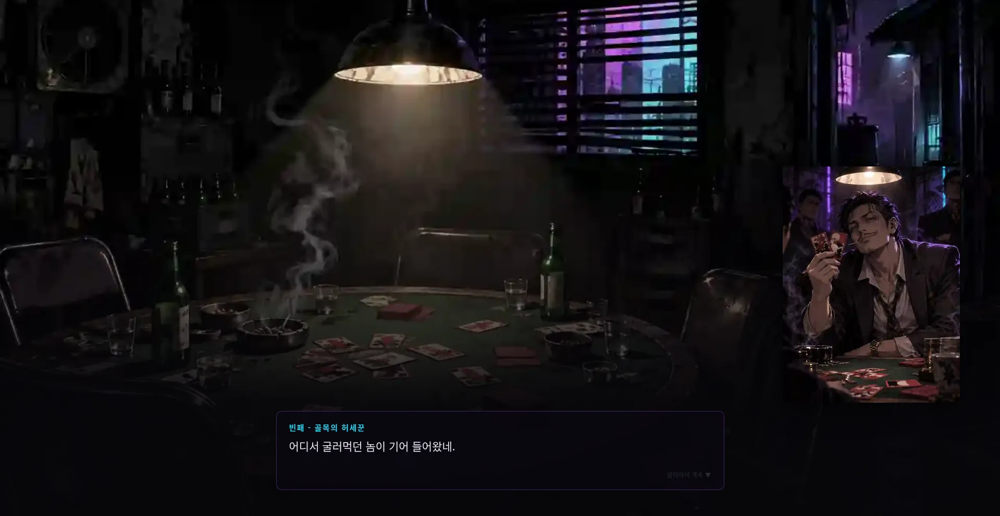
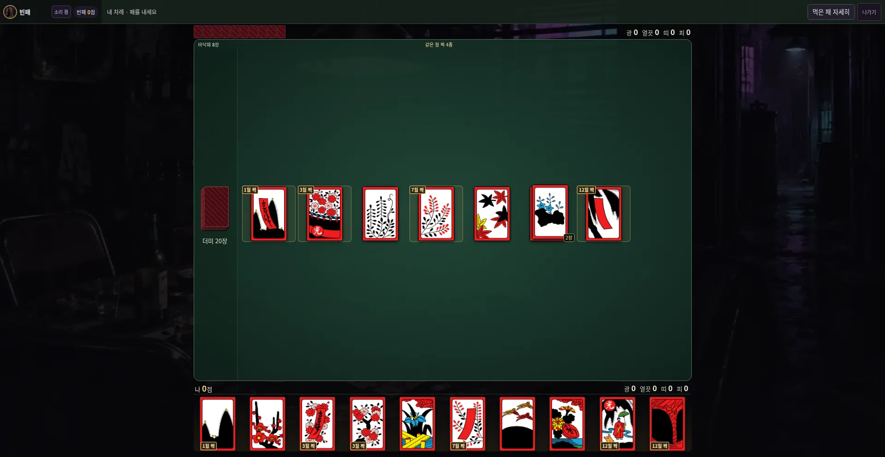
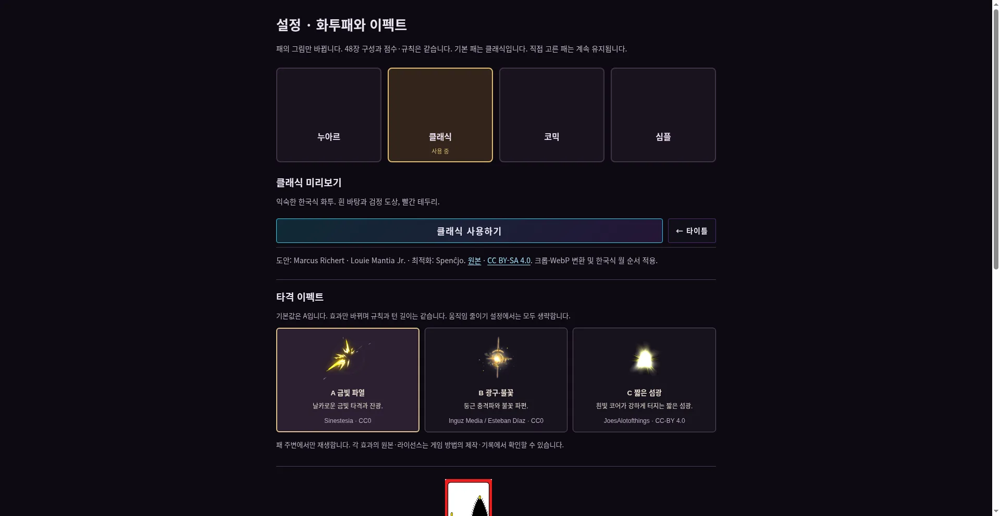

# 맞고2026 : 패담

12인의 오리지널 고수와 겨루는 AI 싱글 맞고 게임입니다. 영화 '타짜' 분위기의 누아르 도박 스토리 위에서 시나리오, 토너먼트, 자유 대국을 즐길 수 있습니다. 실제 돈·구매·현금 보상은 없으며, 혼자 하는 게임을 원하는 플레이어를 위해 만들었습니다.

## 플레이

브라우저에서 바로 실행됩니다.

**https://sigco3111.github.io/gostop2026/**

## 주요 기능

- **시나리오 '밑바닥에서 전설로'**: 12인의 고수를 순서대로 꺾는 12단계 여정. 단계별 도입·승패 대사와 배경, 마지막 승리 후 엔딩과 칭호
- **8인 토너먼트**: 8강→4강→결승, 대진별 3판 2승. 완료한 판까지 대진·승수·이월을 저장하고 타이틀에서 이어하기. 우승 시 트로피와 챔피언 칭호
- **자유 대국**: 12인 전원과 상대별 난이도 1~3(입문·숙련·달인)으로 한 판씩 대국
- **화투패 4종 선택**: 누아르·클래식(한국식)·코믹·심플. 48장 미리보기와 선택 저장, 새 브라우저 기본값은 클래식
- **타격 이펙트 3종 선택**: A 금빛 파열(기본)·B 광구·불꽃·C 짧은 섬광. 패가 닿는 순간 재생
- **고수 열전**: 12인 전신 일러스트와 설정집, 이전/다음 탐색
- **기록과 편의**: 칭호·트로피·승패 기록, 게임 방법·48장 도감·에셋 크레딧 화면, 효과음·선택형 배경음악(기본 끔), 움직임 줄이기 지원, 키보드 조작과 작은 화면 대응

채택 규칙: 화투 48장, 2인 맞고, 손패 10·바닥 8, 7점 고/스톱, 보너스패 없음. 세부 채택안(총통·뻑·국진·피박 처리 등)은 게임 내 안내와 [DEVELOPMENT.md](DEVELOPMENT.md)를 참고하세요. 서비스마다 다른 규칙을 하나의 공식 표준이라고 주장하지 않습니다.

저장은 이 브라우저에만 있습니다. 진행 중인 한 판의 손패는 저장하지 않으며(토너먼트는 완료한 판까지 저장), 탭을 동시에 진행하면 충돌할 수 있으므로 한 탭을 권장합니다.

## 실행 화면

실제 공개 주소(https://sigco3111.github.io/gostop2026/)에서 2026-11-12에 직접 캡처한 화면입니다.

| 타이틀 | 시나리오 12인 |
| --- | --- |
|  |  |

| 도입 대사 | 대국 화면 |
| --- | --- |
|  |  |

| 설정 · 화투패와 이펙트 |
| --- |
|  |

## 설치와 실행

Node.js 20 이상, npm 사용.

```sh
npm ci
npm run dev       # 개발 서버
npm run build     # 타입 검사 후 dist/ 빌드
npm run preview   # 빌드 결과 미리보기
npm test          # 유닛·상태 테스트
```

Vite 기본 경로는 `/gostop2026/`입니다. `dist/`를 해당 경로에서 정적으로 제공하면 됩니다. 다른 경로를 사용할 때에는 `vite.config.ts`의 `base`를 바꾸고 다시 빌드하세요. 파일을 직접 더블클릭하는 방식은 지원하지 않습니다.

Chrome이 설치된 환경에서는 공개 빌드를 대상으로 한 실제 브라우저 검수도 실행할 수 있습니다.

```sh
npm run test:acceptance   # 시나리오·자유 대국·토너먼트·재접속·덱 검사
```

## 기술 내용

- **언어·도구**: TypeScript, Vite 6, Vitest. 외부 프레임워크 없이 DOM을 직접 갱신하는 단일 페이지 앱
- **구조**: `src/engine`(규칙·점수·상태 전이), `src/ui`(화면·대사·효과), `src/data`(카드·고수·스토리 정의)
- **AI**: 입문·숙련·달인 3단계 정책. 12인의 캐릭터는 이 셋 중 하나를 공유하며 각기 독립 AI는 아닙니다
- **저장**: 브라우저 localStorage에 진행·기록·설정을 저장하고 구형 데이터를 이관. 서버·계정·멀티플레이·결제 없음
- **검증**: 유닛·상태 테스트 121개, 3,000시드 상태 전이 검사, 시드 고정 자동 AI 대국(6,000판), puppeteer-core와 axe-core를 이용한 실제 브라우저 UI 검수 스크립트(`test/`)
- **배포**: `main`에 소스, `gh-pages`에 실행 빌드를 게시(GitHub Pages)

### 검증 범위와 한계

2026-11-12 공개 빌드에서 시나리오 12단계 자연 승리·엔딩·재접속 유지, 별도 새 프로필의 토너먼트 6판 우승·트로피 보존, 12인 대사와 A/B/C 이펙트, 320·390·568·844·1280 화면을 확인했습니다. 증거 기록: [최종 소스](https://github.com/sigco3111/gostop2026/commit/9c1eacbaa3d233141c9b2ac94f26093a249bcaa8), [배포 기록](https://github.com/sigco3111/gostop2026/actions/runs/43122811445), `docs/verification/`.

이 검증은 시드와 대기 시간을 조정한 자동 UI 플레이입니다. 실제 휴대기기 터치, 소리 청취, 화면낭독기 발화, 사람이 느끼는 난이도와 재미는 검증하지 않았습니다. 세부 한계는 [DEVELOPMENT.md](DEVELOPMENT.md)에 있습니다.

## 라이선스와 원작 표기

- **코드**: 별도의 코드 라이선스를 아직 지정하지 않았습니다.
- **프로젝트 오리지널 아트**: 12인 캐릭터·단계별 배경·누아르/코믹/심플 화투패는 이 프로젝트를 위해 새로 만든 그림입니다.
- **클래식 화투패 도안**: Marcus Richert / Louie Mantia Jr.의 한국식 화투(Wikimedia 최적화 Spenĉjo), **CC BY-SA 4.0**. 출처·조건·변환 내용은 [ATTRIBUTION](assets/licensed/hwatu/ATTRIBUTION.md)에 있으며, 해당 이미지의 라이선스는 게임 코드와 별개입니다.
- **타격 이펙트**: A 금빛 파열 Sinestesia(CC0), B 광구·불꽃 Inguz Media / Esteban Díaz(CC0), C 짧은 섬광 JoesAlotofthings(**CC-BY 4.0**).
- **효과음**: Card Game sounds / HaelDB(CC0), 54 Casino sound effects / hc(CC0), UI Audio / Kenney(CC0), Win sound effect / Snabisch(CC0).
- **2D 파티클·특수 이펙트**: Particle Pack / Kenney(CC0), 5x Special Effects - 2D / rubberduck(CC0).
- **배경음악**: tension and distress / allen yatsura(CC0).

라이선스 원문은 `licenses/`에, 선정 근거와 적용 상태는 [ASSETS.md](ASSETS.md)에 있습니다.
